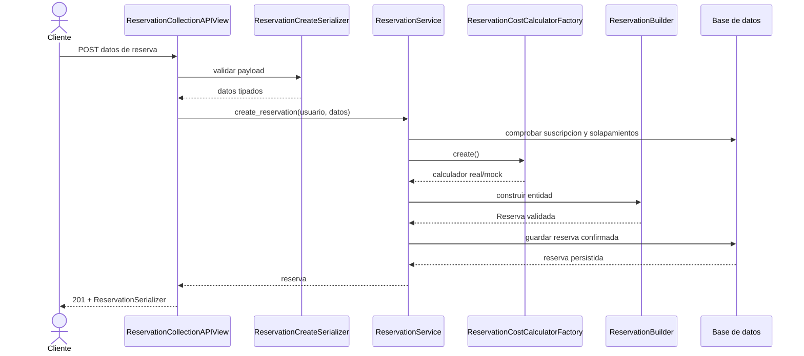

# Coworkhub

API para la gestion de un coworking: usuarios, sedes, espacios, reservas,
finanzas y opiniones. Esta entrega implementa el flujo principal de reservas
con Django REST Framework y una separacion explicita entre presentacion,
aplicacion y dominio.

## Ejecucion local

```powershell
python -m venv .venv
.venv\Scripts\Activate.ps1
pip install -r requirements.txt
python manage.py migrate
python manage.py test
python manage.py runserver
```

La API queda disponible en `http://127.0.0.1:8000/api/reservas/`. Requiere
autenticacion. Para la demostracion se puede usar la sesion del admin o Basic
Authentication con un usuario creado desde `/admin/`.

## Endpoints

| Metodo | URL | Resultado |
|---|---|---|
| GET | `/api/reservas/` | Reservas del usuario autenticado |
| POST | `/api/reservas/` | Crea y confirma una reserva |
| GET | `/api/reservas/<id>/` | Consulta una reserva propia |
| DELETE | `/api/reservas/<id>/` | Cancela una reserva propia antes de su inicio |
| GET | `/api/reservas/disponibilidad/` | Consulta disponibilidad para un espacio y rango |

Ejemplo de entrada:

```json
{
	"espacio_id": 1,
	"fecha_inicio": "2026-09-01T09:00:00Z",
	"fecha_fin": "2026-09-01T11:00:00Z",
	"modalidad_pago": "PAGO_USO"
}
```

Respuestas relevantes: `201` creacion exitosa, `400` datos invalidos,
`404` reserva inexistente o ajena, y `409` conflicto de disponibilidad o
suscripcion o cancelacion.

La consulta de disponibilidad recibe `espacio_id`, `fecha_inicio` y
`fecha_fin` como parametros. Las reservas solo pueden realizarse en el
horario de la sede, el mismo dia, antes de su inicio y en espacios/sedes
activos. Las reservas pendientes y confirmadas bloquean el rango; las
canceladas no lo bloquean.

## Arquitectura y responsabilidades

- `reservas/api_views.py`: recibe HTTP, autentica, invoca el servicio y
	transforma excepciones en codigos HTTP. No calcula precios ni disponibilidad.
- `reservas/serializers.py`: valida forma, tipos, choices y serializa la
	respuesta. No contiene reglas de negocio.
- `reservas/services.py`: caso de uso `ReservationService`; valida
	suscripcion y solapamiento, solicita el calculador al Factory y persiste la
	reserva dentro de una transaccion.
- `reservas/domain/reservation_builder.py`: construye la entidad compleja de
	reserva paso a paso y verifica campos obligatorios/fechas.
- `reservas/infra/factories.py`: Factory selecciona calculador real o mock por
	`COWORKHUB_COST_CALCULATOR`, aislando la variante de calculo.
- `reservas/models.py`, `finanzas/models.py`, `usuarios/models.py` y
	`opiniones/models.py`: entidades persistentes del avance del dominio.
- `opiniones/services.py`: operaciones de publicar, editar y eliminar reseñas;
	las reglas de aplicación no viven en el modelo.

Esta distribucion aplica SRP: cada capa tiene una razon de cambio distinta y
la vista depende del servicio, no de detalles de calculo o persistencia.

## Suscripciones y límites

Las reservas con modalidad `SUSCRIPCION` validan la suscripción activa que
corresponde a la fecha de inicio. El sistema controla las horas consumidas,
el máximo de reservas pendientes o confirmadas y que la reserva termine antes
del vencimiento. Las reservas canceladas dejan de consumir el plan.

Las suscripciones vencidas se marcan automáticamente como `VENCIDA` cuando
se consulta su estado o se intenta reservar. Si tienen renovación automática,
se extiende el período mensual; de lo contrario, quedan vencidas. La vista
`/pagos/suscripciones/` permite cancelar una suscripción activa.

## Pagos y facturación simulados

El proyecto utiliza `SimulatedPaymentGateway`, sin llamadas externas ni
costos. Para demostrar un pago aprobado usa la tarjeta ficticia
`4242 4242 4242 4242`, vencimiento `12/30` y CVV `123`; el sistema valida los
datos, no los almacena y genera automáticamente una `Factura` asociada al
`Pago`. Cualquier dato diferente se rechaza. Esto aplica tanto a pagos individuales de reservas
como a la activación de suscripciones, que permanece en estado `ACTIVA`.

## Reseñas y administración

El usuario puede reseñar una reserva cuando el administrador la marca como
`COMPLETADA` desde `/admin/`. Solo el dueño de la reserva puede crear o editar
la reseña. El administrador puede consultar reseñas, usuarios, sedes,
espacios, reservas, planes, suscripciones, pagos y facturas; además dispone
de roles `Administrador`, `Operador` y `Usuario` y acciones para completar o
cancelar reservas.

Para crear lugares, entra a `http://localhost/admin/` con una cuenta
administradora. En la pantalla inicial usa `+ Nueva sede`, completa nombre,
ciudad, dirección y horario, guarda, y después usa `+ Nuevo espacio` para
asociar una sala u oficina a esa sede. También puedes abrir directamente
`/admin/reservas/sede/add/` o `/admin/reservas/espacio/add/`.

## Secuencia de creacion de reserva



## Preparacion para API Gateway

El Gateway puede enrutar `/api/reservas/*` al servicio HTTP de reservas y
mantener ocultos los modulos internos. La autenticacion, rate limiting,
tracing y CORS pueden centralizarse en el Gateway, mientras Django conserva
autorizacion a nivel de recurso: cada usuario solo consulta sus reservas.
La API usa JSON, codigos HTTP estandar y una URL versionable (`/api/v1/` en
una siguiente iteracion), por lo que puede escalar horizontalmente detras del
Gateway. La logica de aplicacion no depende del servidor web y el Factory
permite sustituir el calculador por una integracion externa sin cambiar la
vista.

## Patrones creacionales

- **Builder:** evita un constructor con muchos parametros para `Reserva` y
	centraliza la construccion valida de la entidad.
- **Factory:** encapsula la seleccion entre calculador real y mock. Para usar
	el mock en pruebas o una demo: `COWORKHUB_COST_CALCULATOR=MOCK`.

## Migracion a microservicios

La cotizacion de reservas fue extraida a un microservicio Flask independiente.
Django conserva usuarios, disponibilidad, suscripciones y persistencia; Flask
calcula el costo a traves de `POST /api/v2/cotizaciones/` y responde JSON.

Para levantar la topologia completa con Nginx:

```powershell
docker compose up --build
```

La documentacion de la matriz de decision, el diagrama y la separacion tecnica
esta en [docs/Migracion-a-Microservicios.md](docs/Migracion-a-Microservicios.md).