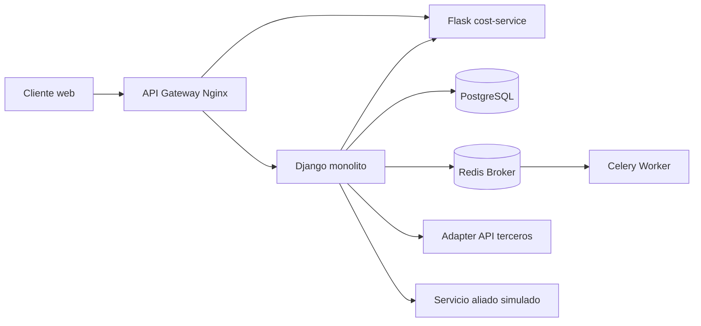

# Entrega 2: implementación local

## Arquitectura



## Componentes implementados

- `django_web`: aplicación principal y API de reservas.
- `flask_cost_service`: microservicio estrangulado de cotizaciones y endpoint
  aliado de demostración.
- `nginx`: gateway que enruta `/api/` y `/api/v2/cotizaciones/`.
- `postgres`: persistencia para Docker Compose.
- `redis` y `celery_worker`: procesamiento asíncrono de confirmaciones.
- `integraciones/adapters.py`: Adapter para una API de clima; usa un proveedor
  HTTP público (`wttr.in`) por defecto, un proveedor HTTP configurable o un
  proveedor demo explícito con `USE_DEMO_WEATHER=1`.
- `integraciones/ally_client.py`: cliente HTTP del servicio aliado.
- `core/tasks.py`: tarea Celery que crea una notificación persistida después
  de confirmar una reserva.

## Ejecución local

```powershell
pip install -r requirements.txt
python manage.py test
docker compose up --build
```

La pantalla `/espacios/` muestra las salas disponibles por sede, la hora local
y el clima consultado mediante el Adapter de la API de terceros. El cambio de idioma se realiza en la
barra superior mediante `/i18n/setlang/`; están configurados español e inglés.
La auditoría de navegación y formularios está en
[Auditoria-UX-UI.md](./Auditoria-UX-UI.md).

## AWS pendiente

El despliegue en AWS Academy no se ejecuta desde este repositorio. Requiere
crear una EC2, instalar Docker Compose, clonar la rama principal, configurar
variables de entorno, ejecutar `docker compose up -d --build`, abrir el puerto
80 y registrar la IP pública/elástica para la sustentación.
